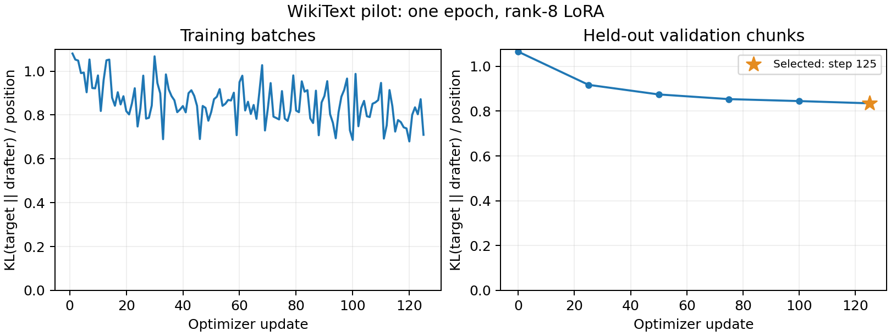

# Demo pilot: probability distillation improved agreement

One short LoRA run reduced validation KL and increased draft acceptance in a
five-article validation benchmark. The trained speculative decoder remained
slower than target-only generation, and BF16 output differences remain. This
is progress evidence, not a final acceleration claim.

[W&B loss curves, examples, and adapter artifacts](https://forge.coreweave.com/wandb/islamassanov66-minerva-university/speculative-decoding/runs/hkays15c)
· [Modal run](https://modal.com/apps/islam-95550/main/ap-e4w6GvgoOaYVjQ8U7SiY6S)
· [Raw training and evaluation JSON](training.json).

## What ran

- Frozen Qwen3-4B teacher and Qwen3-0.6B drafter on NVIDIA A10, BF16/SDPA.
- Rank-8 LoRA on query/value projections: 1,146,880 trainable parameters.
- One shuffled pass over 500 × 256-token training chunks; 128,000 positions.
- Microbatch one, accumulation four, 125 AdamW updates, learning rate 1e-4,
  zero weight decay, clipping at 1.0, temperature one, no dropout.
- Full-vocabulary `KL(target || drafter)` on fixed text prefixes, without
  activation distillation, labels, or model-generated training text.
- All 50 validation chunks evaluated every 25 updates, including update zero.
  The lowest validation KL selected update 125. These are pilot settings, not
  a hyperparameter optimum.

The exact training implementation was commit
`da3c8d907ca1ab3d71995317b3f2410356b2d9d8`.
The GPU function took 198.6 seconds before final upload/teardown and peaked at
9.93 GiB allocated during training. This duration is not a billing total.

## Loss and agreement

| Metric | Before training | Selected adapter |
| --- | ---: | ---: |
| Validation KL / position | 1.06523 | 0.83503 |
| Teacher-forced top-one agreement | 58.68% | 63.88% |

Validation KL fell 21.61%. After merging the adapter into BF16 weights, KL was
0.83559 and top-one agreement was 63.77%; the small merge effect is recorded
separately. Both training and validation use article-separated fixed samples.
Improvement on this validation set does not establish generalization to other
domains or show that training has converged.

## Generation comparison

All three methods ran in the same job on the same five validation extracts:
128-token prompt, up to 64 generated tokens, batch one, k=4, two repetitions,
rotating execution order. Both inference drafters were plain Qwen modules;
the trained adapter was merged before measuring. Timings include prefill,
drafting, verification, and cache management, and exclude loading/warm-up.

| Metric | Original drafter | Trained drafter |
| --- | ---: | ---: |
| Speculative tokens/sec | 22.50 | 24.40 |
| Retained draft acceptance | 44.06% | 51.67% |
| Generated tokens / target verification | 2.689 | 2.963 |
| Accepted draft tokens / target verification | 1.714 | 2.000 |
| Raw throughput / target-only throughput | 0.669× | 0.725× |

Target-only generation achieved **33.64 tokens/sec**. Trained speculative
throughput was 8.46% higher than original speculative throughput; the two
repetition ratios were 1.081× and 1.088×. Original and trained speculative
outputs were identical in all ten paired cases, which makes that within-pilot
timing comparison easier to interpret. Five articles and two repetitions are
insufficient for a broad performance claim or reliable confidence interval.

Both speculative variants differed from target-only BF16 generation in 8/10
paired sequences, with 172/640 differing output positions. These are sequence
discrepancies after divergence, not a conditional per-token error probability.
The previous [numerical follow-up](BASELINE.md) reproduced first divergences at
identical prefixes with BF16 top-logit ties and found exact agreement in a
separate FP32-target check on the original drafter. That FP32 control was not
rerun on the trained adapter. The report keeps `verified_speedup: null` for
both variants, and claims no lossless target-only acceleration.

## Checks and saved outputs

CPU checks covered KL direction/normalization, frozen base weights, adapter
updates, and save/reload/merge fidelity on a tiny real Qwen. The full job checked
that the target had no gradients, adapter weights changed, and restored best
weights exactly matched the saved adapter. Both datasets' hashes and token
lengths were checked. No held-out test file was mounted or evaluated.

Best/final adapter hashes are identical because update 125 won validation
selection. Both are W&B model artifacts attached to the run and persisted in:

`spec-dec-benchmark-model-cache:/project-runs/hkays15c/{best,last}/`

Local copies are ignored by Git under `results/adapters-hkays15c/`; their hashes
are in the raw JSON. Checkpoints contain only adapter weights/configuration,
not a second copy of the base model. To reproduce the experiment, run
`MODAL_PROFILE=islam-95550 python train.py` from a clean committed checkout.
This creates a new W&B run and new checkpoint directory rather than replacing
these results.

## What remains for the assignment

The implementation now runs data → training → validation → generation
comparison, with inspectable loss curves, outputs, and sanity checks. The demo
submission still needs the one-page progress PDF and a 2–5-minute recording
with its link. The repository README explains reproduction and expected output.

For the final project: tune k on validation, consider more training tokens and
longer contexts, address numerical comparison explicitly, then freeze settings
before evaluating held-out test prompts. Code/instruction experiments and broad
context-length sweeps are deferred beyond this demo to keep the pilot small.
