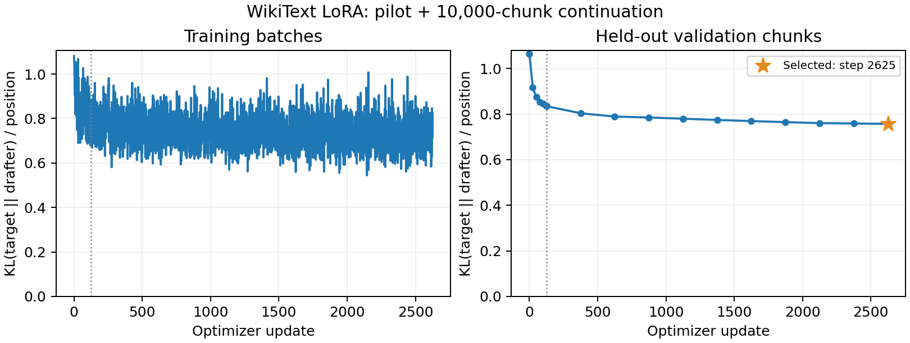

# 10k-chunk continuation: lower KL, modest throughput gains

The existing [W&B training run](https://forge.coreweave.com/wandb/islamassanov66-minerva-university/speculative-decoding/runs/hkays15c)
continued from the pilot's adapter weights at update 125 through update 2,625.
Validation KL improved, but speculative generation remains slower than
target-only generation on this small benchmark.

[Raw results](training-10k.json) ·
[Completed Modal job](https://modal.com/apps/islam-95550/main/ap-efMtyj0w5sDmAtCTeX4d4P) ·
[Original pilot](TRAINING.md).

## Training and selection

One shuffled pass over 10,000 article-separated, 256-token training chunks
added 2.56 million token positions and 2,500 optimizer updates. The first 500
chunks also appeared in the pilot, so cumulative exposure is 2.688 million
positions, not that many unique tokens. The fixed 50 validation chunks and
held-out test prompts were unchanged; test prompts were not evaluated.

The frozen Qwen3-4B teacher and Qwen3-0.6B drafter used the same A10, BF16/SDPA,
rank-8 query/value LoRA, full-vocabulary KL, learning rate 1e-4, microbatch one,
and accumulation four as the pilot. Adam moments restarted because the pilot
saved only adapter weights. This reset is recorded in the run configuration;
it is a weight continuation, not an exact optimizer-state resume.

All 50 validation chunks were evaluated at the start and every 250 new updates.
The lowest KL selected update 2,625. Adapter and optimizer/RNG checkpoints were
saved every 250 updates. Source commit:
`14b64c0fa895cce4a5601b5453788525b6c9e94b`.

The dotted boundary marks the end of the 125-update pilot. Training points use
different article batches; validation points always use the same fixed chunks.

| Metric | Start: update 125 | Selected: update 2,625 |
| --- | ---: | ---: |
| Validation KL / position | 0.83503 | 0.75725 |
| Teacher-forced top-one agreement | 63.88% | 65.68% |

KL fell 9.31% during the continuation, or 28.91% relative to the untrained
drafter's 1.06523. After merging into BF16 weights, KL was 0.75745 and top-one
agreement 65.64%. This establishes improvement on this validation set, not
convergence, an optimal learning rate, or generalization to other domains.

The logged gradient norm is measured before clipping to 1.0. Across the 2,500
new updates its median was 0.736, maximum 1.836, and 0.96% exceeded 1.0.
Losses and gradient norms remained finite. These measurements and falling
validation KL do not show an exploding-gradient problem. No learning-rate
sweep was performed.

## Same-job generation comparison

The original and trained drafters were evaluated against target-only generation
on the same five validation extracts: 128 prompt tokens, 64 generated tokens,
batch one, k=4, two repetitions with rotating execution order. Both drafters
were plain models with no adapter execution overhead. Timing includes prefill,
drafting, verification, and cache management, excluding loading and warm-up.

| Metric | Original drafter | Trained drafter |
| --- | ---: | ---: |
| Speculative tokens/sec | 22.36 | 24.85 |
| Retained draft acceptance | 44.06% | 52.80% |
| Generated tokens / target verification | 2.689 | 2.991 |
| Accepted draft tokens / target verification | 1.714 | 2.028 |
| Raw throughput / target-only throughput | 0.680× | 0.756× |

Target-only generation achieved **32.87 tokens/sec**. The trained drafter was
11.16% faster than the original drafter in this job; repetition ratios were
1.108× and 1.115×. Original and trained speculative outputs were identical in
all ten paired cases. The earlier 500-chunk pilot measured 24.40 tokens/sec
with its trained drafter in a separate job; that cross-job difference is not
a controlled timing comparison between the two trained checkpoints.

Both speculative variants differed from target-only in 8/10 paired sequences,
with 172/640 differing output positions. These are discrepancies after sequence
divergence, not a conditional token error rate. The earlier BF16 numerical
diagnosis is in [the baseline report](BASELINE.md); its FP32 control was not
repeated here. `verified_speedup` remains null. Five articles and two repetitions
are insufficient for a broad performance claim or reliable confidence interval.

## Saved outputs and execution

W&B history continues on the same run and actual optimizer-update axis.
The new best/last adapters are new artifact versions and are stored separately
from the pilot under:

`spec-dec-benchmark-model-cache:/project-runs/hkays15c/continuation-126-2625/`

Local checksummed copies are under `results/adapters-hkays15c/training-10k/`,
including `training_state.pt`. The GPU function took 1,634.6 seconds before
final upload/teardown and peaked at 9.93 GiB allocated during training; this is
not a billing total. All 2,500 update numbers were checked for continuity.

A separate CPU-only read-only metrics probe initially failed at startup because
its remote image lacked the `train` module. The corrected probe succeeded, but
the first app kept restarting until explicitly stopped. It did not train or
create a W&B run. The training/evaluation job completed independently. After
cleanup, Modal's container listing was empty. Billing for the failed probe was
not checked.

## Remaining work

The demo still needs its one-page progress PDF and 2–5-minute recording.
For the final project, tune k on validation, address numerical equivalence,
and evaluate longer contexts before freezing settings and opening the test set.
No additional training or GPU sweep was started after this run.
